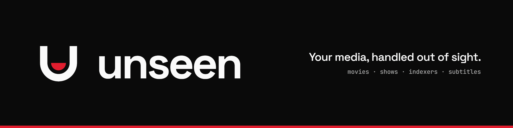

# Unseen

One self-hosted app that replaces Sonarr, Radarr, Prowlarr and Bazarr, including
multiple Sonarr/Radarr instances. Status: M0 (foundation) is built; no
feature for users yet.

## Goal

- One binary, one port, one SQLite file.
- Multi-user from the start: the first account is the Owner, everyone else
  only has what the Owner grants through roles.
- Compatible with an existing Sonarr/Radarr setup: same folders, same download
  clients, same companion tools.

Unseen does not replace the download or VPN layer. qBittorrent, SABnzbd and
Gluetun stay separate containers that Unseen drives through their APIs.

## Architecture

| Part | Choice |
|---|---|
| Backend | Rust, Axum, Tokio, SeaORM 2 on SQLite |
| Auth | Better Auth RS for authentication, app-owned roles and permissions |
| API types | utoipa generates OpenAPI, openapi-typescript generates the client |
| Live updates | Server-Sent Events |
| Frontend | SvelteKit 3, Svelte 5, Tailwind v4, shadcn-svelte, static build |
| Packaging | Frontend embedded in the binary with rust-embed, small Docker image |

```
crates/api/         Axum routes, SSE, OpenAPI, auth wiring, permission extractor
crates/core/        domain logic, no HTTP
crates/db/          SeaORM entities, queries, migrations
crates/arr-compat/  Sonarr/Radarr v3 DTOs, mapping, import client
web/                SvelteKit app
docs/               design documents
```

URL space:

```
/                   UI
/api/v1/...         Unseen API
/api/auth/...       authentication endpoints
/radarr/api/v3/...  Radarr-compatible subset
/sonarr/api/v3/...  Sonarr-compatible subset (after V1)
```

Details: [docs/02-architecture.md](docs/02-architecture.md).

## Compatibility statement

"Compatible" means four things, each with a limited scope
([docs/14-compatibility.md](docs/14-compatibility.md)):

1. **On disk**: adopt an existing Radarr/Sonarr library in place. Same default
   naming, same template tokens, same hardlink behaviour.
2. **Concepts**: same quality names, quality profiles, root folders, tags,
   monitored state and minimum availability.
3. **Import**: one-way, read-only import from running Radarr/Sonarr instances.
4. **API**: the subset of the v3 API that companion tools need. V1 targets
   Seerr against `/radarr`.

Not goals: a 100% drop-in v3 API, writing back to Sonarr/Radarr, reading their
databases, running their plugins or custom scripts.

## Roadmap

| Milestone | Result |
|---|---|
| M0 Foundation | Workspace, app shell, embedded UI, CI, Docker image, auth spike, design docs |
| M1 Accounts and permissions | Owner setup, login, roles, users, API keys, audit log |
| M2 Movies library | Add movies from TMDB, collections, quality profiles, adopt a Radarr folder |
| M3 Search | Torznab indexers, custom formats, manual search, scored results |
| M4 Download and import | qBittorrent, live progress, Radarr-compatible import |
| M5 Automation | Scheduler, RSS sync, automatic search, TRaSH guides |
| M6 Radarr compatibility | Import from Radarr, `/radarr/api/v3`, Seerr works |
| **V1 line** | **movies, torrents, qBittorrent, accounts, custom formats, Radarr compatibility** |
| M7 TV shows | Shows, seasons, episodes, season packs |
| M8 Sonarr compatibility | Adopt and import Sonarr, `/sonarr/api/v3` |
| M9 Usenet | Newznab and SABnzbd |
| M10 Subtitles | OpenSubtitles |
| M11 Polish | Notifications, backup/restore, 2FA/passkeys, Prowlarr import, user docs |

## Contributing

See [CONTRIBUTING.md](CONTRIBUTING.md).
