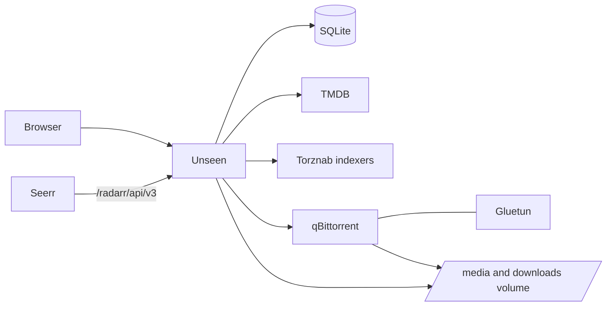
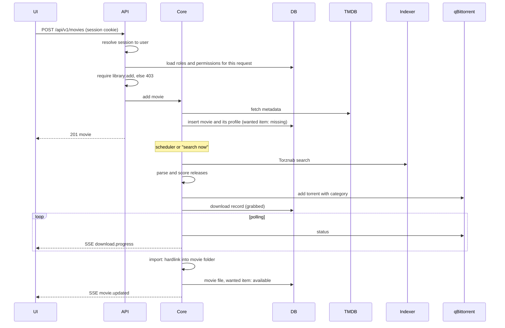

# 02 Architecture overview

Status: reviewed (2026-11-16).

## Components and containers

| Container | Contains | Network |
|---|---|---|
| `unseen` | One binary: API, embedded UI, scheduler, SQLite file | LAN or reverse proxy |
| `gluetun` | VPN tunnel | Internet through VPN |
| `qbittorrent` | Torrent client, uses the `gluetun` network | Behind VPN |
| `sabnzbd` | Usenet client (M9) | Direct |

Unseen talks to indexers and TMDB directly, not through the VPN. An optional
HTTP or SOCKS5 proxy can be set for indexer traffic
([08-integrations.md](08-integrations.md)).



## URL space

```
/                   UI (static files embedded in the binary, SPA fallback)
/api/v1/...         Unseen API. OpenAPI is the source of truth.
/api/auth/...       Better Auth RS endpoints
/radarr/api/v3/...  Radarr-compatible subset
/sonarr/api/v3/...  Sonarr-compatible subset (M8)
```

Radarr and Sonarr both use `/api/v3` with overlapping paths. External tools
are configured with URL base `/radarr` or `/sonarr`.

## Crates

| Crate | Contains | May depend on |
|---|---|---|
| `core` | Domain logic, permission catalog, parsing, scoring, custom formats, traits for storage, metadata providers and external services | nothing in the workspace |
| `db` | SeaORM entities, generated auth schema, queries, migrations | `core` |
| `arr-compat` | Radarr/Sonarr v3 DTOs, mapping to and from core types, import client | `core` |
| `api` | Axum routes, SSE, OpenAPI, auth wiring, permission extractor, static files, `main` | `core`, `db`, `arr-compat` |

Rules:
- `core` has no HTTP server code and no SeaORM types.
- `arr-compat` never touches the database. `api` connects it to `db`.
- Only `api` knows about Axum and builds the Better Auth instance. `db`
  depends on `better-auth` (feature `seaorm2` only) because the generated
  auth schema needs its derives.

Open question: does `core` hold the HTTP clients for TMDB, Torznab and
qBittorrent, or do they go in a separate `integrations` crate?

## Request flow: add a movie until it is in the library



Every request is authenticated by a session cookie or an API key, then
checked against exactly one permission. See [15-permissions.md](15-permissions.md).

## Startup order

1. Read configuration.
2. Open SQLite and run migrations.
3. Build the Better Auth instance (it validates entities, not the database).
4. Recover in-flight downloads ([06-state-machines.md](06-state-machines.md)).
5. Start the scheduler and the HTTP server.
