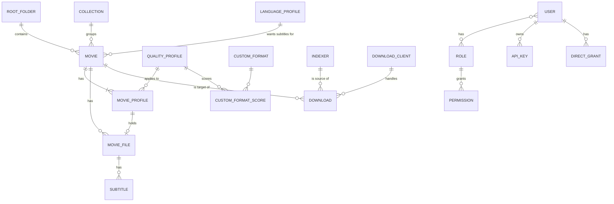
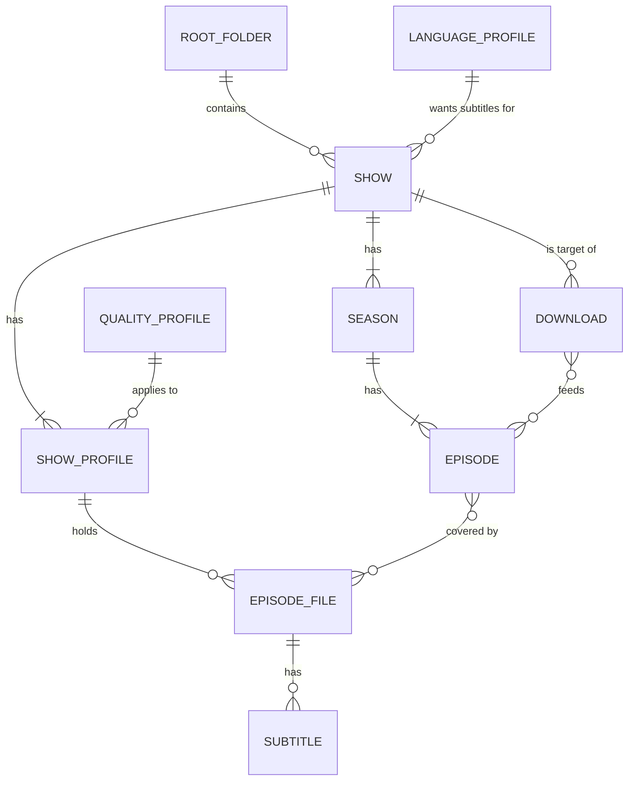

# 03 Domain model and glossary

Status: reviewed (2026-11-16). Terms match Sonarr/Radarr unless the "Differs" column says so.

## Entities

| Term | Meaning | Differs from Sonarr/Radarr |
|---|---|---|
| Movie | A film identified by its TMDB id. Has a root folder, one or more quality profiles, tags, monitored state and minimum availability. | Radarr: exactly one profile |
| Movie profile | One quality profile attached to a movie. Holds at most one file. One of them is the primary profile. | New. Replaces a second Radarr instance |
| Collection | A TMDB collection (for example a film series). Can be monitored: its missing movies are added automatically. | No |
| Metadata provider | A source of titles, dates, images and ids. TMDB in V1, TVDB in M7. | Upstream has one fixed source |
| Show, season, episode | TV entities (M7), defined in [TV (M7)](#tv-m7). | Radarr/Sonarr say "series"; the compat API keeps "series" |
| Root folder | A directory that contains one folder per movie or show. | No |
| Quality | A named source and resolution pair, for example `Bluray-1080p`. | No |
| Quality profile | Allowed qualities in order, a cutoff, a language, custom format scores, and whether upgrades are allowed. | Also replaces separate instances |
| Quality definition | Minimum, preferred and maximum size per minute for one quality. | No |
| Custom format | A named set of conditions on a release (name pattern, source, resolution, language, size and others). A quality profile gives each custom format a score. | No |
| TRaSH guide | The community guide that publishes custom formats, score sets and quality sizes. Unseen reads its published JSON. | Upstream needs Recyclarr or manual import |
| Tag | A label on items, indexers and download clients. | No |
| Monitored | Unseen searches for the item. | No |
| Minimum availability | Earliest release stage at which to search: `announced`, `inCinemas`, `released`. | No |
| Wanted item | A monitored movie profile that has no file or whose file is below cutoff. | No separate name upstream |
| Indexer | A Torznab or Newznab endpoint. | Managed in Unseen, not in Prowlarr |
| Release | One search result from an indexer: a name, a size, a download link. Nothing is downloaded yet. | No |
| Grab | The act of sending a release to a download client. | No |
| Download | A release that a download client is handling. Has progress and a state. | Upstream calls this a "queue item" |
| File | A media file inside the library, linked to a movie or episode. A movie can have several: one per movie profile, plus unmanaged files found on disk. | Upstream: "movie file", one per movie |
| Import | Hardlink, copy or rename of a finished download into the library. | No |
| Adopt | Register existing library files without moving them. | Upstream: "library import" |
| Instance import | One-way copy of settings and items from a running Radarr/Sonarr. | New |
| Download client | qBittorrent or SABnzbd. | No |
| Subtitle | A subtitle file next to a media file, with a language and a kind (normal, hearing impaired or forced). Imported with the video, or downloaded from a subtitle provider (M10). | Bazarr, not Radarr or Sonarr |
| Language profile | A named, ordered list of wanted subtitles (language and kind) with an optional cutoff. A movie has at most one. | Bazarr: "language profile" |
| Subtitle provider | A source of subtitles. OpenSubtitles in V1. | Bazarr: "provider" |
| Blocklist | Releases that failed and must not be grabbed again. | No |
| User | An account. | Upstream has one user |
| Owner | Built-in role with every permission. | New |
| Role | A named set of permissions, created at runtime. | New |
| Permission | A fixed `resource:action` string defined in code. | New |
| Direct grant | A permission given to one user without a role. | New |
| Audit log | A record of who changed what: sign-ins, users, roles, keys, settings, integrations, deletions. | New |
| API key | A secret that belongs to a user, limited to a subset of that user's permissions. | Upstream has one global key |

## Release, download, file

- A **release** exists on an indexer. Unseen stores it only when grabbed.
- A **download** exists in a download client. It ends when imported, failed or removed.
- A **file** exists in the library. It outlives its download.

## Relationships

## Several files per movie

Decided 2026-11-15, see ADR 0010.

- A movie has one or more movie profiles, for example `HD-1080p` and
  `Ultra-HD`. Each movie profile is searched, downloaded and upgraded on its
  own and holds at most one file.
- The first profile is the primary profile. The Radarr-compatible API shows
  the primary profile and its file, because Radarr's resource has room for
  one.
- Files found on disk that belong to no profile (a second cut, an old copy)
  are kept as unmanaged files. Unseen lists them and never upgrades or
  deletes them on its own.
- Editions are a property of a file, not a separate slot. To keep two
  editions on purpose, use two profiles or leave one unmanaged.

## Subtitles (M10)

Decided in the subtitles design, see [08-integrations.md](08-integrations.md)
for the provider and [09-filesystem.md](09-filesystem.md) for the names.

- A **language profile** lists the subtitles a movie wants, in order: each
  item is a language (`en`, `fr`, `pt-BR`) and a kind. The kinds are
  `normal`, `hi` (hearing impaired, SDH) and `forced` (foreign parts only).
  The optional **cutoff** is an item: once that item and every item before
  it exist, Unseen stops looking. Without a cutoff Unseen looks for every
  item.
- A movie has one language profile, or none (no subtitles wanted). The
  setting `subtitles.default_profile_id` gives the profile of a new movie.
  The profile belongs to the movie, not to its movie profiles: a 1080p and a
  2160p file of the same movie get the same languages.
- A **subtitle** belongs to a movie file and is unique for its language and
  kind. A file has at most one subtitle per language and kind.
  Embedded subtitle tracks are not read or listed in V1.
- A subtitle is **wanted** when the movie is monitored, has a language
  profile and a file, and an item of the profile up to the cutoff has no
  subtitle yet.
- Subtitle files found next to a video are subtitles too: they are
  recorded at import and by a library scan, with no provider. A downloaded
  subtitle never replaces one that was imported or added by the user.
- Replacing the video file keeps its subtitles: they are renamed with the
  new file. A subtitle that came from a provider is searched again only when
  the user asks. Not for V1: syncing subtitles to a new cut of the film.

## TV (M7)

Decided in the TV design. Tables are in [04-database.md](04-database.md),
the state of an episode in [06-state-machines.md](06-state-machines.md),
release names in [07-release-scoring.md](07-release-scoring.md) and file
names in [09-filesystem.md](09-filesystem.md). TV follows the movie model
unless this section says otherwise.

### Terms

| Term | Meaning | Differs from Sonarr |
|---|---|---|
| Show | A TV series identified by a provider id (TVDB or TMDB). Has a root folder, one or more show profiles, tags, a series type, a monitored state and a language profile. | Sonarr: "series", exactly one profile. The compat API keeps "series" |
| Series type | `standard`, `daily` or `anime`. Decides how a release name is matched to episodes and which naming template is used. | No |
| Season | A numbered group of episodes of one show, with a monitored flag. Season 0 holds the specials. | No |
| Episode | One instalment, identified by show, season number and episode number. Has an air date, a title, a runtime, a monitored flag and an optional absolute number. | No |
| Absolute number | The running count of regular episodes across seasons. Anime release names use it. Null when the provider gives none. | No |
| Show profile | One quality profile attached to a show. Holds at most one file per episode. One of them is the primary profile. | New. Same idea as a movie profile |
| Episode file | A media file in the library. It covers one episode, or several when the file is a multi-episode release. | Same |
| Multi-episode release | One release and one file that cover two or more consecutive episodes of a season (`S01E01E02`). | Same |
| Season pack | One release with one file per episode, for the episodes of a season. One download, many files. | Same |
| Wanted episode | A monitored, aired episode of a monitored show that has no file for a show profile, or whose file is below that profile's cutoff. | No separate name upstream |

### Several profiles per show

ADR 0010 applies to shows. Without it the TV half of Unseen would still need
the second Sonarr instance for 4K.

- A show has one or more show profiles. Each (episode, show profile) pair is
  its own wanted item: searched, downloaded and upgraded on its own, with at
  most one managed file.
- The first show profile is the primary profile. The Sonarr-compatible API
  shows the primary profile and its files.
- Files on disk that belong to no profile are unmanaged: listed, never
  upgraded or deleted automatically.
- A download targets one show profile. A season pack feeds the wanted items of
  that profile only.

### Metadata provider and numbering

The question was "TMDB only, or TVDB as well". **TVDB as well.** The
provider trait and the TVDB client are already planned (M7, #134); this
section settles what that means for the model.

- Sonarr, its libraries and the TRaSH guides identify a show by its TVDB id and
  number its episodes in TVDB's aired order. Seerr calls Sonarr with
  `tvdbId` (`GET /series?tvdbId=`, `GET /series/lookup?term=tvdb:{id}`), see
  [14-compatibility.md](14-compatibility.md).
- Release names follow the same numbering. For anime, TVDB also gives the
  absolute number. TMDB has none, and its season split differs from TVDB for
  many shows.
- TMDB stays: it is the provider of V1, it needs no extra key and it knows
  shows that TVDB lacks.

Rules:

- A show stores `tvdb_id`, `tmdb_id` and `imdb_id`. At least one of
  `tvdb_id` and `tmdb_id` is set. The ids of the other provider are filled
  from the provider's external ids when it gives them; they feed the compat
  API and lookups by that id.
- The show has one **numbering provider**, `shows.metadata_provider`. Its
  seasons, episode numbers, absolute numbers and air dates are the ones
  Unseen stores, and the ones a release name is matched against.
- The numbering provider is chosen when the show is added: the first provider
  in the provider order (a setting, see #134) that knows the show. The default
  order is TVDB, then TMDB. TVDB is skipped while no TVDB key is configured.
- Lookups fall back to the next provider when one fails. A refresh does not:
  it asks the numbering provider only. Another provider could number the same
  show differently, and renumbering episodes would detach their files.
- A lookup by `tvdb:{id}` in a library without TVDB access goes through
  TMDB's find by external id.
- Not for V1: changing the numbering provider of an existing show, TVDB's
  DVD and other orders, TMDB episode groups.

### Series types and numbering

| Series type | A release name is matched by | Example |
|---|---|---|
| `standard` | Season and episode number | `Show.S01E02.1080p.WEB-DL-GRP` |
| `daily` | Air date | `Show.2024.05.17.720p.HDTV-GRP` |
| `anime` | Absolute number, or season and episode number when the name has them | `[Group] Show - 12 [1080p]` |

- Matching uses the numbering of the show's provider. Scene numbering (groups
  that number differently from TVDB) is an open question.
- An anime release that has only an absolute number cannot be matched while
  the episodes have no `absolute_number` (a TMDB show). It is rejected with
  that reason.
- Season 0 is the specials. They are never monitored by the monitoring
  options of the add form; the user monitors them by hand.

### Monitoring and the wanted episode

- Show, season and episode each have a monitored flag. An episode is searched
  only when its show and the episode are monitored.
- Setting the season flag sets the flag of all its episodes. It also decides
  new episodes: after a refresh adds an episode, the episode is monitored when
  the show's `monitor_new_items` is `all` and its season is monitored.
  A new season is monitored when `monitor_new_items` is `all`. The compat API
  names the field `monitorNewItems`.
- The add form (and `POST /series` through `addOptions.monitor`) sets the
  flags once, then forgets the choice:

  | Option | Monitors |
  |---|---|
  | `all` | Every episode except the specials |
  | `future` | Every episode that has not aired yet, except the specials |
  | `missing` | Every episode without a file, except the specials. Differs from `all` once existing files are adopted |
  | `none` | Nothing |

  Sonarr's enum has more values (`existing`, `firstSeason`, `lastSeason`,
  `pilot`, `recent`, `monitorSpecials`, `unmonitorSpecials`, `skip`). They
  are not offered; the compat API answers 400 and names the value.

- An episode is **aired** when its `air_date_utc` is in the past, or when that
  is null and its `air_date` is before today (UTC). The air date replaces
  minimum availability: an unaired episode, or one without an air date
  (to be announced), is not a wanted episode.
- A wanted episode is not searched while it is covered by an active download
  of the same show profile.

### Refresh

A scheduled task asks the numbering provider for each continuing show (and on
demand). It adds new episodes and seasons, and updates titles, air dates,
runtimes and numbers. An episode that the provider no longer lists is deleted
when it has no file and no active download; otherwise it stays, is
unmonitored and keeps its numbers.

### Subtitles for TV

The language profile belongs to the show, as it belongs to the movie, and a
subtitle belongs to an episode file (`subtitles.episode_file_id`). The rules of
[the subtitles section](#subtitles-m10) apply per episode file. Table changes
come with the subtitle migration, see
[04-database.md](04-database.md#tv-tables-m7).

### TV decisions (2026-11-25)

- TVDB as well as TMDB. A show has one numbering provider, kept for life.
- Shows get several profiles and files, as movies do (ADR 0010).
- Series types `standard`, `daily` and `anime`, as Sonarr. Absolute numbers
  are stored when the provider gives them and used for matching anime names.
- The monitoring options of the add form are `all`, `future`, `missing` and
  `none`.
- An unaired episode is never wanted. There is no minimum availability for TV.

### TV open questions

- Scene numbering and scene name mappings (releases numbered differently from
  the provider). Not before the parser exists (#90).
- Multi-season packs. Sonarr grabs them only by hand; so does the draft in
  [07-release-scoring.md](07-release-scoring.md).
- TVDB access: its v4 API needs a key from the project and may need a
  subscriber PIN. Verify the terms before #134 and say in the settings what
  the Owner has to enter.
- Absolute numbers for TMDB shows: derive them from the aired order, or leave
  anime on TMDB without them.

## Decisions (2026-11-15)

- One movie can have several files: yes, through movie profiles.
- Collections are an entity in V1.

## Open questions

- How does the compat API treat a request from Seerr for a movie that exists
  with another profile (the "4K server" case)? Draft: `POST /movie` with a
  new `qualityProfileId` adds a movie profile. To verify with Seerr in M6.
