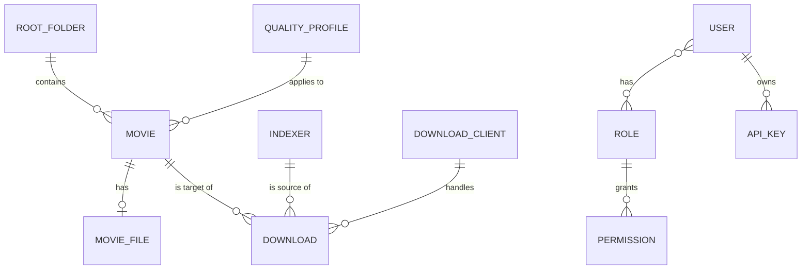

# 03 Domain model and glossary

Status: draft. Terms match Sonarr/Radarr unless the "Differs" column says so.

## Entities

| Term | Meaning | Differs from Sonarr/Radarr |
|---|---|---|
| Movie | A film identified by its TMDB id. Has a root folder, a quality profile, tags, monitored state and minimum availability. | No |
| Show, season, episode | TV entities (M7). | Radarr/Sonarr say "series"; the compat API keeps "series" |
| Root folder | A directory that contains one folder per movie or show. | No |
| Quality | A named source and resolution pair, for example `Bluray-1080p`. | No |
| Quality profile | Allowed qualities in order, a cutoff, and whether upgrades are allowed. | Also replaces separate instances |
| Tag | A label on items, indexers and download clients. | No |
| Monitored | Unseen searches for the item. | No |
| Minimum availability | Earliest release stage at which to search: `announced`, `inCinemas`, `released`. | No |
| Wanted item | A monitored item that has no file or is below cutoff. | No separate name upstream |
| Indexer | A Torznab or Newznab endpoint. | Managed in Unseen, not in Prowlarr |
| Release | One search result from an indexer: a name, a size, a download link. Nothing is downloaded yet. | No |
| Grab | The act of sending a release to a download client. | No |
| Download | A release that a download client is handling. Has progress and a state. | Upstream calls this a "queue item" |
| File | A media file inside the library, linked to a movie or episode. | Upstream: "movie file", "episode file" |
| Import | Hardlink, copy or rename of a finished download into the library. | No |
| Adopt | Register existing library files without moving them. | Upstream: "library import" |
| Instance import | One-way copy of settings and items from a running Radarr/Sonarr. | New |
| Download client | qBittorrent or SABnzbd. | No |
| Blocklist | Releases that failed and must not be grabbed again. | No |
| User | An account. | Upstream has one user |
| Owner | Built-in role with every permission. | New |
| Role | A named set of permissions, created at runtime. | New |
| Permission | A fixed `resource:action` string defined in code. | New |
| API key | A secret that belongs to a user, limited to a subset of that user's permissions. | Upstream has one global key |

## Release, download, file

- A **release** exists on an indexer. Unseen stores it only when grabbed.
- A **download** exists in a download client. It ends when imported, failed or removed.
- A **file** exists in the library. It outlives its download.

## Relationships

## Open questions

- Can one movie have several files (editions, 1080p and 4K side by side)?
  Radarr allows one. Draft: one.
- Is a collection (TMDB collection) an entity in V1? Draft: no.
