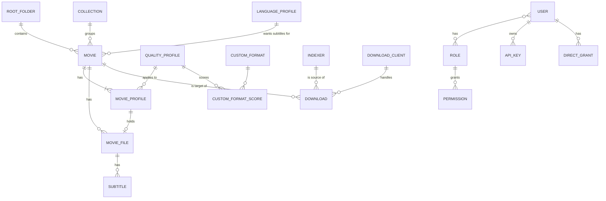

# 03 Domain model and glossary

Status: reviewed (2026-11-16). Terms match Sonarr/Radarr unless the "Differs" column says so.

## Entities

| Term | Meaning | Differs from Sonarr/Radarr |
|---|---|---|
| Movie | A film identified by its TMDB id. Has a root folder, one or more quality profiles, tags, monitored state and minimum availability. | Radarr: exactly one profile |
| Movie profile | One quality profile attached to a movie. Holds at most one file. One of them is the primary profile. | New. Replaces a second Radarr instance |
| Collection | A TMDB collection (for example a film series). Can be monitored: its missing movies are added automatically. | No |
| Metadata provider | A source of titles, dates, images and ids. TMDB in V1, TVDB in M7. | Upstream has one fixed source |
| Show, season, episode | TV entities (M7). | Radarr/Sonarr say "series"; the compat API keeps "series" |
| Root folder | A directory that contains one folder per movie or show. | No |
| Quality | A named source and resolution pair, for example `Bluray-1080p`. | No |
| Quality profile | Allowed qualities in order, a cutoff, a language, custom format scores, and whether upgrades are allowed. | Also replaces separate instances |
| Quality definition | Minimum, preferred and maximum size per minute for one quality. | No |
| Custom format | A named set of conditions on a release (name pattern, source, resolution, language, size and others). A quality profile gives each custom format a score. | No |
| TRaSH guide | The community guide that publishes custom formats, score sets and quality sizes. Unseen reads its published JSON. | Upstream needs Recyclarr or manual import |
| Tag | A label on items, indexers and download clients. | No |
| Monitored | Unseen searches for the item. | No |
| Minimum availability | Earliest release stage at which to search: `announced`, `inCinemas`, `released`. | No |
| Wanted item | A monitored movie profile that has no file or whose file is below cutoff. | No separate name upstream |
| Indexer | A Torznab or Newznab endpoint. | Managed in Unseen, not in Prowlarr |
| Release | One search result from an indexer: a name, a size, a download link. Nothing is downloaded yet. | No |
| Grab | The act of sending a release to a download client. | No |
| Download | A release that a download client is handling. Has progress and a state. | Upstream calls this a "queue item" |
| File | A media file inside the library, linked to a movie or episode. A movie can have several: one per movie profile, plus unmanaged files found on disk. | Upstream: "movie file", one per movie |
| Import | Hardlink, copy or rename of a finished download into the library. | No |
| Adopt | Register existing library files without moving them. | Upstream: "library import" |
| Instance import | One-way copy of settings and items from a running Radarr/Sonarr. | New |
| Download client | qBittorrent or SABnzbd. | No |
| Subtitle | A subtitle file next to a media file, with a language and a kind (normal, hearing impaired or forced). Imported with the video, or downloaded from a subtitle provider (M10). | Bazarr, not Radarr or Sonarr |
| Language profile | A named, ordered list of wanted subtitles (language and kind) with an optional cutoff. A movie has at most one. | Bazarr: "language profile" |
| Subtitle provider | A source of subtitles. OpenSubtitles in V1. | Bazarr: "provider" |
| Blocklist | Releases that failed and must not be grabbed again. | No |
| User | An account. | Upstream has one user |
| Owner | Built-in role with every permission. | New |
| Role | A named set of permissions, created at runtime. | New |
| Permission | A fixed `resource:action` string defined in code. | New |
| Direct grant | A permission given to one user without a role. | New |
| Audit log | A record of who changed what: sign-ins, users, roles, keys, settings, integrations, deletions. | New |
| API key | A secret that belongs to a user, limited to a subset of that user's permissions. | Upstream has one global key |

## Release, download, file

- A **release** exists on an indexer. Unseen stores it only when grabbed.
- A **download** exists in a download client. It ends when imported, failed or removed.
- A **file** exists in the library. It outlives its download.

## Relationships

## Several files per movie

Decided 2026-11-15, see ADR 0010.

- A movie has one or more movie profiles, for example `HD-1080p` and
  `Ultra-HD`. Each movie profile is searched, downloaded and upgraded on its
  own and holds at most one file.
- The first profile is the primary profile. The Radarr-compatible API shows
  the primary profile and its file, because Radarr's resource has room for
  one.
- Files found on disk that belong to no profile (a second cut, an old copy)
  are kept as unmanaged files. Unseen lists them and never upgrades or
  deletes them on its own.
- Editions are a property of a file, not a separate slot. To keep two
  editions on purpose, use two profiles or leave one unmanaged.

## Subtitles (M10)

Decided in the subtitles design, see [08-integrations.md](08-integrations.md)
for the provider and [09-filesystem.md](09-filesystem.md) for the names.

- A **language profile** lists the subtitles a movie wants, in order: each
  item is a language (`en`, `fr`, `pt-BR`) and a kind. The kinds are
  `normal`, `hi` (hearing impaired, SDH) and `forced` (foreign parts only).
  The optional **cutoff** is an item: once that item and every item before
  it exist, Unseen stops looking. Without a cutoff Unseen looks for every
  item.
- A movie has one language profile, or none (no subtitles wanted). The
  setting `subtitles.default_profile_id` gives the profile of a new movie.
  The profile belongs to the movie, not to its movie profiles: a 1080p and a
  2160p file of the same movie get the same languages.
- A **subtitle** belongs to a movie file and is unique for its language and
  kind. A file has at most one subtitle per language and kind.
  Embedded subtitle tracks are not read or listed in V1.
- A subtitle is **wanted** when the movie is monitored, has a language
  profile and a file, and an item of the profile up to the cutoff has no
  subtitle yet.
- Subtitle files found next to a video are subtitles too: they are
  recorded at import and by a library scan, with no provider. A downloaded
  subtitle never replaces one that was imported or added by the user.
- Replacing the video file keeps its subtitles: they are renamed with the
  new file. A subtitle that came from a provider is searched again only when
  the user asks. Not for V1: syncing subtitles to a new cut of the film.

## Decisions (2026-11-15)

- One movie can have several files: yes, through movie profiles.
- Collections are an entity in V1.

## Open questions

- How does the compat API treat a request from Seerr for a movie that exists
  with another profile (the "4K server" case)? Draft: `POST /movie` with a
  new `qualityProfileId` adds a movie profile. To verify with Seerr in M6.
