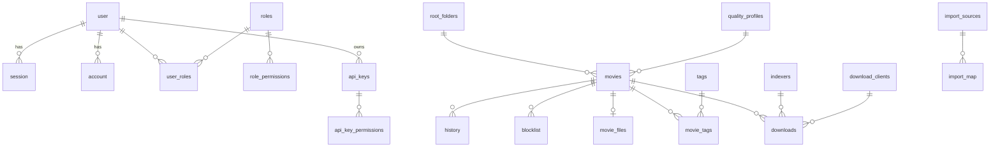

# 04 Database schema

Status: draft. V1 tables only. TV, Usenet and subtitle tables come with their
milestones.

## Rules

- SQLite, one file, WAL mode, `foreign_keys = ON`.
- SeaORM 2 entities in `crates/db`. Schema changes are versioned migrations
  with `sea-orm-migration`, run at startup. No automatic schema sync outside
  local development.
- Auth tables and app tables are migrated together by our migrator.
- Primary keys of app tables: `INTEGER PRIMARY KEY`. The compat API needs
  integer ids.
- Timestamps: UTC, ISO 8601 text.
- Drop from entities to raw SQL only for: bulk upserts during import, FTS,
  and reports that need window functions. Keep raw SQL inside `crates/db`.

## Auth tables (generated)

Generated by `better-auth-rs generate` into `crates/db/src/auth_schema.rs`.
Marked **generated**: do not edit by hand, do not rename tables or columns.

Rule for changes: regenerate the file with `just gen-auth`, then write one of
our own migrations that applies the difference. `create_auth_tables` runs only
in the first migration; it fails if tables exist and never alters them.

The columns below are the expected upstream Better Auth core schema. Confirm
them against the generated file in the M0 spike.

| Table | Columns |
|---|---|
| `user` | `id` text PK, `name`, `email` unique, `emailVerified` bool, `image` null, `createdAt`, `updatedAt` |
| `session` | `id` text PK, `token` unique, `userId` FK user, `expiresAt`, `ipAddress` null, `userAgent` null, `createdAt`, `updatedAt` |
| `account` | `id` text PK, `userId` FK user, `accountId`, `providerId`, `password` null (hash), token columns null, `createdAt`, `updatedAt` |
| `verification` | `id` text PK, `identifier`, `value`, `expiresAt`, `createdAt`, `updatedAt` |

App columns added to `user` (allowed on the four core entities):
`disabled` bool not null default false.

## Access control tables

| Table | Columns | Keys and constraints |
|---|---|---|
| `roles` | `id` int PK, `name` text, `description` text null, `is_owner` bool default false, `created_at`, `updated_at` | unique(`name`); partial unique index where `is_owner` = 1 |
| `role_permissions` | `role_id` int FK roles cascade, `permission` text | PK(`role_id`, `permission`) |
| `user_roles` | `user_id` text FK user cascade, `role_id` int FK roles cascade | PK(`user_id`, `role_id`); index(`role_id`) |
| `api_keys` | `id` int PK, `user_id` text FK user cascade, `name`, `key_hash` text, `key_prefix` text, `last_used_at` null, `created_at`, `revoked_at` null | unique(`key_hash`); index(`user_id`) |
| `api_key_permissions` | `api_key_id` int FK api_keys cascade, `permission` text | PK(`api_key_id`, `permission`) |

The Owner role has no rows in `role_permissions`. `is_owner` means "every
permission in the catalog". Unknown permission strings in the database are
ignored at load time.

`api_keys` is used only if the spike rejects the Better Auth API-key plugin
(ADR 0006).

## Library tables

| Table | Columns | Keys and constraints |
|---|---|---|
| `root_folders` | `id` int PK, `path` text, `created_at` | unique(`path`) |
| `quality_profiles` | `id` int PK, `name`, `upgrade_allowed` bool, `cutoff_quality_id` int, `items` json (ordered qualities and groups, allowed flag), `created_at`, `updated_at` | unique(`name`) |
| `tags` | `id` int PK, `label` text | unique(`label`) |
| `movies` | `id` int PK, `tmdb_id` int, `imdb_id` text null, `title`, `original_title` null, `sort_title`, `year` int, `overview` null, `runtime` int null, `status` text, `in_cinemas` null, `digital_release` null, `physical_release` null, `poster_path` null, `root_folder_id` int FK, `folder_name` text, `quality_profile_id` int FK, `monitored` bool, `minimum_availability` text, `added_at`, `updated_at` | unique(`tmdb_id`); index(`quality_profile_id`); index(`root_folder_id`) |
| `movie_tags` | `movie_id` FK cascade, `tag_id` FK cascade | PK(`movie_id`, `tag_id`) |
| `movie_files` | `id` int PK, `movie_id` int FK cascade, `relative_path` text, `size` int, `quality_id` int, `release_group` null, `edition` null, `scene_name` null, `media_info` json null, `added_at` | unique(`movie_id`) in V1 |

Qualities are a Rust enum in `core` with fixed ids, not a table.

## Search and download tables

| Table | Columns | Keys and constraints |
|---|---|---|
| `indexers` | `id` int PK, `name`, `kind` text (`torznab`), `url`, `api_key` text (secret), `categories` json, `priority` int default 25, `enabled` bool, `created_at` | unique(`name`) |
| `download_clients` | `id` int PK, `name`, `kind` text (`qbittorrent`), `url`, `username` null, `password` null (secret), `category` text, `enabled` bool, `created_at` | unique(`name`) |
| `downloads` | `id` int PK, `movie_id` int FK, `indexer_id` int null FK set null, `download_client_id` int FK, `client_download_id` text (torrent hash), `release_title`, `quality_id` int, `size` int, `state` text, `error` null, `attempts` int default 0, `grabbed_at`, `completed_at` null, `imported_at` null | unique(`download_client_id`, `client_download_id`); index(`state`); index(`movie_id`) |
| `blocklist` | `id` int PK, `movie_id` int FK cascade, `release_title`, `indexer_id` null, `reason`, `created_at` | index(`movie_id`) |
| `history` | `id` int PK, `movie_id` int null FK set null, `event` text, `data` json, `created_at` | index(`movie_id`, `created_at`) |

## System tables

| Table | Columns | Keys |
|---|---|---|
| `settings` | `key` text PK, `value` json, `updated_at` | |
| `scheduled_tasks` | `name` text PK, `interval_seconds` int, `last_run_at` null, `last_status` null, `last_error` null | |
| `import_sources` | `id` int PK, `kind` text (`radarr`), `name`, `url`, `api_key` (secret), `target_quality_profile_id` int null FK, `last_import_at` null | unique(`url`) |
| `import_map` | `source_id` int FK cascade, `resource` text, `source_resource_id` int, `local_id` int | PK(`source_id`, `resource`, `source_resource_id`) |

`import_map` makes instance import safe to re-run.

## ER diagram

## Open questions

- Are secrets (`api_key`, `password`) encrypted at rest? See [11-security.md](11-security.md).
- Is `quality_profiles.items` JSON, or a child table?
- Do tags also apply to indexers and download clients in V1, as in Radarr?
- Exact auth columns: confirm from the generated file.
