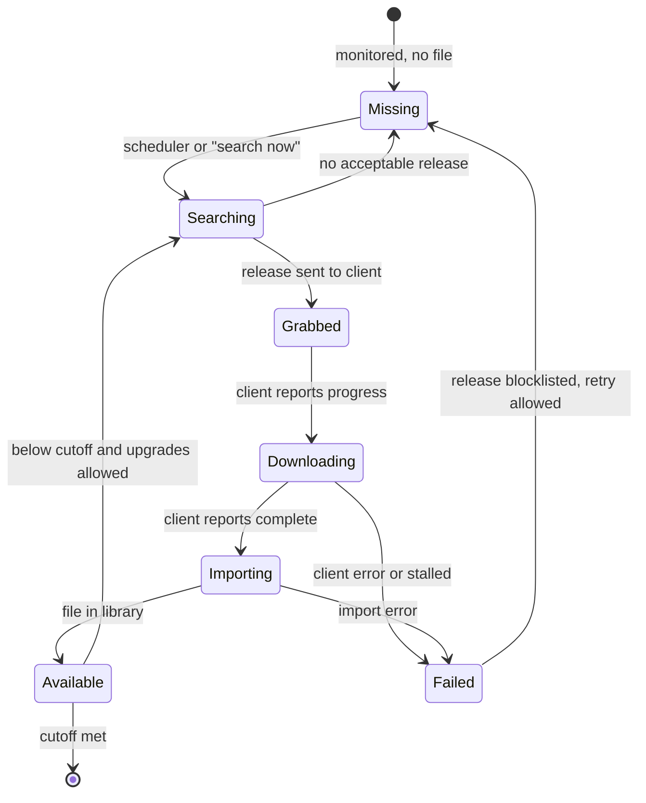
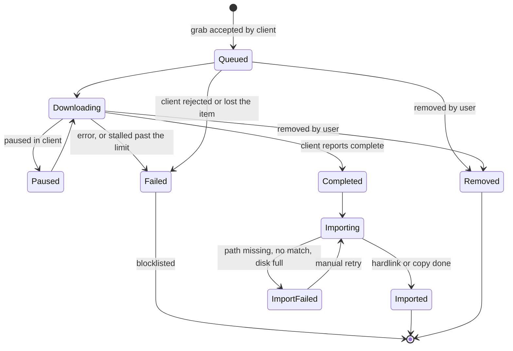
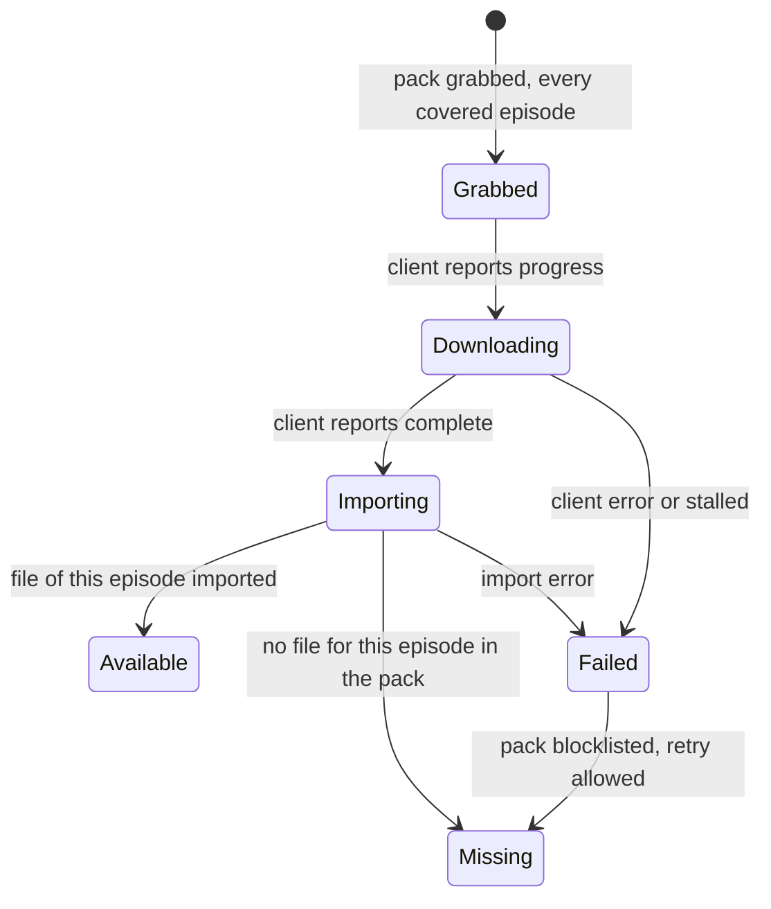

# 06 State machines

Status: reviewed (2026-11-16).

## Wanted item

A wanted item is one movie profile of a monitored movie that has no file, or
whose file is below the profile cutoff. A movie with two profiles has two
wanted items with independent states. The state is derived from the movie
profile, its file and its active download; only the download state is stored.

Rules:
- A movie is not searched before its minimum availability is reached.
- One active download per movie profile.
- After `Failed`, the release goes on the blocklist and the next search skips it.

## Download

Stored in `downloads.state`.

## Retries

| Failure | Behaviour |
|---|---|
| Download client unreachable | Keep state, retry on next poll, mark client unhealthy after 3 misses |
| Item missing from client | `Failed` after 2 consecutive polls |
| Stalled (no progress) | `Failed` after `downloads.stalled_timeout_minutes` without progress, default 360 (6 hours); 0 turns it off. Time while paused or while the client is unreachable does not count. |
| Import error | `ImportFailed`, no automatic retry, manual retry in the queue |
| Indexer error during search | Skip that indexer, back off, do not fail the item |

## Restart

On startup, before the scheduler runs:

1. Load downloads whose state is not final (`Imported`, `Failed`, `Removed`).
2. Ask each client for those items by `client_download_id`.
3. Reconcile: update state from the client; items missing from the client go
   to `Failed`.
4. `Importing` at crash time: run the import again. Import is idempotent: a
   hardlink that already exists with the same inode counts as success.

Nothing is held only in memory. A search that was in progress is simply lost;
the item is `Missing` again and the next run picks it up.

## Removal from the download client

Each download client has the option "remove completed downloads", default
off, as in Radarr.

- Off: Unseen never removes a torrent. Seeding rules stay with the client.
- On: after the import succeeded and the client reports that seeding is
  finished (its ratio or time limit is reached and the torrent is stopped),
  Unseen removes the torrent and its data from the client. The library file
  is a hardlink or a copy and is not affected.
- A failed download is removed from the client when it is blocklisted,
  whatever the option says.

## TV (M7)

The wanted item of a show is one episode with one show profile (a wanted
episode, see [03-domain-model.md](03-domain-model.md#tv-m7)). It has the
states and transitions of the wanted item above. Its state is derived from the
episode's managed file for that profile and from the active download that
lists the episode in `download_episodes`. The download state machine below is
unchanged. The differences are these.

Rules:
- An episode is not searched before it has aired. This replaces minimum
  availability. An episode without an air date is not wanted.
- A wanted episode has at most one active download per show profile. A release
  is not grabbed when one of the episodes it covers is already in an active
  download of the same profile. A season pack is therefore refused while one of
  its episodes is downloading on its own, and a single episode is refused while
  a pack that covers it is downloading. A manual grab is refused the same way
  (409, naming the download); the user removes the download first.
- Unmonitoring an episode or a show does not cancel an active download. Its
  files are imported.
- A season pack or multi-episode release is one download. Its episodes move
  together to `Grabbed`, `Downloading` and `Importing`, and one by one to
  `Available`.

### Season pack

- The pack is one row in `downloads` with one row per covered episode in
  `download_episodes`. Its state is the download state above.
- A file of the pack imports only for an episode in `download_episodes`.
  Other video files in the pack are skipped and listed in the history.
- The download is `Imported` when no file failed to import and at least one
  episode got its file. A file that cannot be imported (target folder missing,
  disk full, name collision) makes the download `ImportFailed`. The manual
  retry imports only the files that are not in the library yet. A pack from
  which no file matches an episode is `ImportFailed`, with the reason
  "no match".
- An episode of an `Imported` pack that got no file (the pack lacked it, or
  only a sample was there) is `Missing` again. The next search may grab it on
  its own. The pack is not blocklisted for that.
- A `Failed` pack is blocklisted for the show. The next search for its season
  skips that release, tries other packs, then goes episode by episode.

### Restart

The restart steps above apply to every download. For a pack, an `Importing`
download is imported again file by file. A file that is already in the library
at the target path, with the same inode, counts as imported, so the rerun
creates no duplicate row in `episode_files`. The targets come from
`download_episodes`, not from a new decision.

### Removal from the download client

For a pack, "after import" means after every file has been imported or
skipped. The client removes nothing earlier.

### TV decisions (2026-11-25)

- A pack download is one row, with its episodes in a join table. Each episode
  reaches `Available` on its own.
- A release that overlaps an active download of the same profile is not
  grabbed, by the scheduler or by hand.
- Partial import is not a failure: skipped files and episodes the pack
  lacked go back to the normal flow.

## Decisions (2026-11-15)

- Removal after import is a per-client option, default off.
- Stalled limit default: 6 hours. Long enough for slow swarms and for
  metadata fetches on rare torrents, short enough that a dead torrent is
  replaced the same day.
