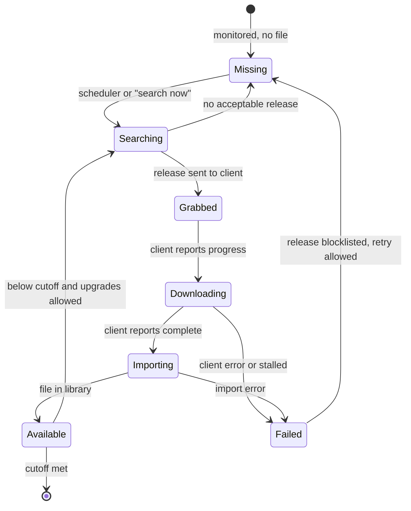
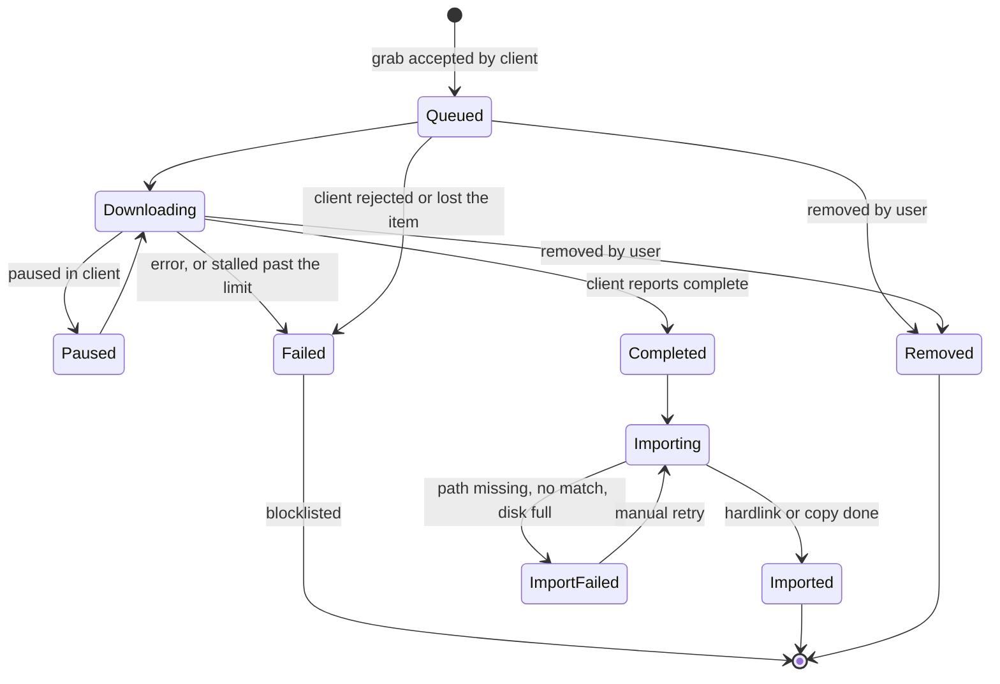

# 06 State machines

Status: draft.

## Wanted item

A wanted item is one movie profile of a monitored movie that has no file, or
whose file is below the profile cutoff. A movie with two profiles has two
wanted items with independent states. The state is derived from the movie
profile, its file and its active download; only the download state is stored.

Rules:
- A movie is not searched before its minimum availability is reached.
- One active download per movie profile.
- After `Failed`, the release goes on the blocklist and the next search skips it.

## Download

Stored in `downloads.state`.

## Retries

| Failure | Behaviour |
|---|---|
| Download client unreachable | Keep state, retry on next poll, mark client unhealthy after 3 misses |
| Item missing from client | `Failed` after 2 consecutive polls |
| Stalled (no progress) | `Failed` after `downloads.stalled_timeout_minutes` without progress, default 360 (6 hours); 0 turns it off. Time while paused or while the client is unreachable does not count. |
| Import error | `ImportFailed`, no automatic retry, manual retry in the queue |
| Indexer error during search | Skip that indexer, back off, do not fail the item |

## Restart

On startup, before the scheduler runs:

1. Load downloads whose state is not final (`Imported`, `Failed`, `Removed`).
2. Ask each client for those items by `client_download_id`.
3. Reconcile: update state from the client; items missing from the client go
   to `Failed`.
4. `Importing` at crash time: run the import again. Import is idempotent: a
   hardlink that already exists with the same inode counts as success.

Nothing is held only in memory. A search that was in progress is simply lost;
the item is `Missing` again and the next run picks it up.

## Removal from the download client

Each download client has the option "remove completed downloads", default
off, as in Radarr.

- Off: Unseen never removes a torrent. Seeding rules stay with the client.
- On: after the import succeeded and the client reports that seeding is
  finished (its ratio or time limit is reached and the torrent is stopped),
  Unseen removes the torrent and its data from the client. The library file
  is a hardlink or a copy and is not affected.
- A failed download is removed from the client when it is blocklisted,
  whatever the option says.

## Decisions (2026-11-15)

- Removal after import is a per-client option, default off.
- Stalled limit default: 6 hours. Long enough for slow swarms and for
  metadata fetches on rare torrents, short enough that a dead torrent is
  replaced the same day.
